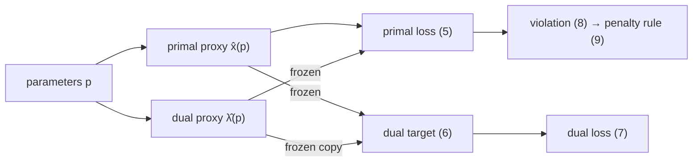

# L2OALM.jl

[](https://github.com/LearningToOptimize/L2OALM.jl/actions/workflows/CI.yml?query=branch%3Amain)
[](https://codecov.io/gh/LearningToOptimize/L2OALM.jl)
[](https://LearningToOptimize.github.io/L2OALM.jl/dev/)
[](https://LearningToOptimize.github.io/L2OALM.jl/stable/)

**Self-supervised primal-dual learning with an augmented Lagrangian.**
L2OALM learns a *primal proxy* `x̂(p)` and a *dual proxy* `λ̂(p)` for a family
of constrained optimization problems `min f(x; p) s.t. l ≤ c(x; p) ≤ u`
without solving any instance: the primal proxy minimises the augmented
Lagrangian for the multipliers predicted by the dual proxy, and the dual proxy
learns the augmented-Lagrangian multiplier update, with the penalty increased
whenever the violation stalls. This is PDL, Park & Van Hentenryck,
[*Self-Supervised Primal-Dual Learning for Constrained Optimization*](https://arxiv.org/abs/2208.09046),
AAAI 2023. Problems can be stated in JuMP or in ExaModels; with ExaModels the
batch is evaluated by GPU-capable kernels.



## Installation

`L2OCore` is not registered yet:

```julia
using Pkg
Pkg.add(url = "https://github.com/LearningToOptimize/LearningToOptimize.jl",
        subdir = "lib/L2OCore", rev = "ar/l2ocore-design")
Pkg.add(url = "https://github.com/LearningToOptimize/L2OALM.jl")
Pkg.add(["JuMP", "Lux", "Optimisers", "Zygote"])
```

## Example

```julia
using JuMP, L2OCore, L2OALM, Lux, Optimisers, Zygote, Random

model = Model()
@variable(model, p[1:2] in MOI.Parameter(1.0))
@variable(model, -2 <= x[1:3] <= 2)
@constraint(model, x[1] + x[2] + x[3] == p[1])
@constraint(model, x[1] - x[2] <= p[2])
@objective(model, Min, sum(x .^ 2) + x[1] - 3x[3])
problem = ParametricProblem(model)

method = ALMMethod(; ρ_init = 1.0, α = 2.0, τ = 0.8, ρmax = 1e3)
pipe = L2OPipeline(problem, method)
sampler = BoxSampler(fill(-1.0, 2), fill(1.0, 2))
data = generate_data(pipe; sampler, n = 256)          # parameters only

rng = Random.Xoshiro(0)
primal = Chain(Dense(2, 32, tanh), Dense(32, 3))
dual = Chain(Dense(2, 32, tanh), Dense(32, num_duals(problem); init_weight = zeros64, init_bias = zeros64))
(ps, st), (pd, sd) = Lux.setup(rng, primal), Lux.setup(rng, dual)
trainer = ALMTrainer(Training.TrainState(primal, f64(ps), st, Adam(1e-2)),
                     Training.TrainState(dual, f64(pd), sd, Adam(1e-2)))
train!(trainer, pipe, data; outer_iterations = 10, primal_epochs = 15, dual_epochs = 15,
       batchsize = 64, rng)

P = L2OCore.sample_parameters(sampler, rng, 32)
pred = complete(pipe, P, L2OCore.predict_batch(trainer, P))
evaluate(pipe, P, pred)            # objectives and violations per instance
```

## What you need to provide

  - A parametric problem: a JuMP model with `MOI.Parameter` variables
    (LP, convex QP or smooth NLP with element-wise constraint sets), or an
    ExaModel with `parameter`s wrapped in a BatchNLPKernels `BatchModel`.
  - A sampler of parameters (e.g. `BoxSampler`) or a parameter matrix.
  - Two proxies: Lux models for the built-in training loop (any callable for
    custom loops), the dual one with `num_rows` outputs.

## What you get

  - Losses of the paper as plain array functions (`primal_loss`,
    `dual_target`, `dual_loss`, `violation_measure`, `update_penalty`) that run
    on GPU arrays and differentiate with array AD.
  - The training loop of Algorithm 1 (`train!`, Lux extension).
  - Multipliers projected onto the correct sign, and variable bounds
    enforced by construction with `SigmoidBoundMap` or `HardSigmoidBoundMap`.
    Feasibility of the other constraints and optimality are measured with
    `evaluate` (violations, objective gaps).

## In the LearningToOptimize ecosystem

L2OALM implements `L2OCore.AbstractPrimalDualMethod` from
[LearningToOptimize.jl](https://github.com/LearningToOptimize/LearningToOptimize.jl)
(problems, pipelines, evaluators), evaluates ExaModels
problems with [BatchNLPKernels.jl](https://github.com/LearningToOptimize/BatchNLPKernels.jl),
and sits next to [DecisionRules.jl](https://github.com/LearningToOptimize/DecisionRules.jl)
and the other method packages of the organisation.

## Citation

If you use L2OALM, please cite the method:

```bibtex
@inproceedings{park2023pdl,
  title     = {Self-Supervised Primal-Dual Learning for Constrained Optimization},
  author    = {Park, Seonho and Van Hentenryck, Pascal},
  booktitle = {Proceedings of the AAAI Conference on Artificial Intelligence},
  volume    = {37},
  pages     = {4052--4060},
  year      = {2023}
}
```

and the software (see [`CITATION.cff`](CITATION.cff)). Contributions are welcome:
see [`CONTRIBUTING.md`](CONTRIBUTING.md).
