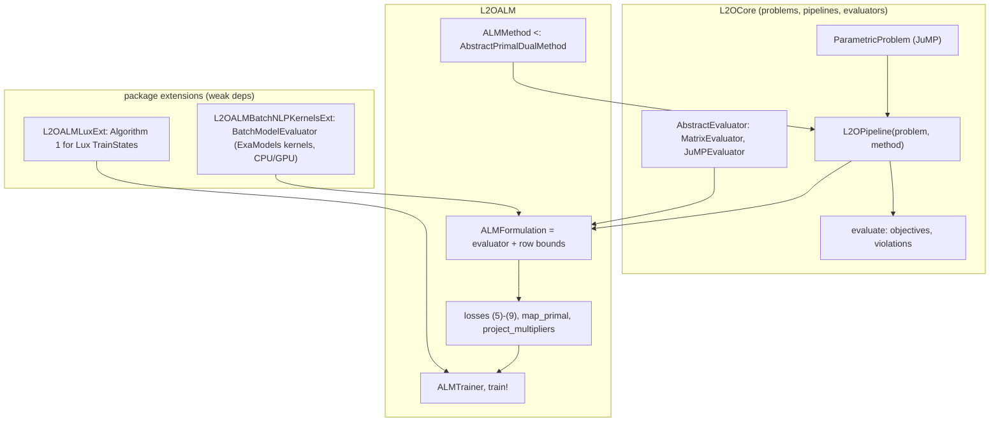

```@meta
CurrentModule = L2OALM
```

# Design

## Place in the ecosystem



Sibling packages: [LearningToOptimize.jl](https://github.com/LearningToOptimize/LearningToOptimize.jl)
(L2OCore, datasets, penalty method),
[BatchNLPKernels.jl](https://github.com/LearningToOptimize/BatchNLPKernels.jl)
(batched ExaModels kernels),
[DecisionRules.jl](https://github.com/LearningToOptimize/DecisionRules.jl)
(multistage decision rules).

## Decisions

**Method = hyper-parameters.** `ALMMethod` holds no problem data; the problem
enters through `L2OPipeline` (JuMP) or `ALMFormulation(bm)` (ExaModels). The
same method value can be reused across problems, and the number of equality
rows no longer needs to be passed by hand: rows with `l == u` are equalities.

**One evaluation interface.** Losses only call `L2OCore.batch_objective` and
`L2OCore.constraint_values` on `form.evaluator`, plus broadcasts with the
formulation's bound vectors. A problem stated in JuMP or ExaModels therefore
reaches the same code:

| front end | evaluator | differentiable | device |
|:--|:--|:--|:--|
| JuMP, LP/QP with affine parameters | `L2OCore.MatrixEvaluator` | yes (array AD) | CPU (sparse matrices) |
| JuMP, nonlinear | `L2OCore.JuMPEvaluator` | no (checks, finite differences) | CPU |
| ExaModels | `BatchModelEvaluator` (this package's extension) | yes (BatchNLPKernels rules) | CPU or GPU (KernelAbstractions) |

Planned in L2OCore (not here): JuMP → ExaModels conversion so a nonlinear JuMP
problem gets the kernel evaluator, and a BatchOptInterface bridge to ExaModels
and NLPModels. Once those exist, `ALMFormulation(pipe)` picks them up through
`pipe.evaluator` with no change in this package.

**GPU.** The package needs no GPU dependency. The kernel evaluator runs on
the ExaModel's backend; the formulation's vectors are the ExaModel's
`lcon/ucon/lvar/uvar` (device arrays); the losses use broadcasts, `sum` and
`maximum` only; the training loop indexes columns with integer vectors, which
GPU arrays support. CI runs on CPU; the GPU path is the same code with a
`CUDABackend()` ExaModel and `gpu_device()` Lux states.

**Lightweight core.** Hard dependencies: L2OCore, JuMP (already required by
L2OCore), ChainRulesCore and Random. Lux and BatchNLPKernels are weak
dependencies. CUDA and LuxCUDA, previously hard dependencies, are not needed
by the package at all.

## Machine-learning frameworks

PDL needs only **first-order** gradients of scalar losses with respect to the
proxy parameters: the multipliers in the primal phase and the targets in the
dual phase are computed outside the differentiated closure. No input
gradients appear inside a loss, so no nested AD is required.

| framework / AD | status | evidence |
|:--|:--|:--|
| Lux + Zygote | supported, tested | `test/test_lux.jl`, `test/test_batchnlp.jl` |
| any callable + Zygote | supported | losses are plain array functions; gradients checked against finite differences in the test suite |
| Flux, Enzyme, other backends | expected to work, not tested | add a `train!` method for their state types; `ad` keyword of the Lux loop accepts any ADTypes backend that Lux supports |

Derivative (Sobolev) supervision, which needs input gradients inside the
loss and hence nested AD, is a method-agnostic wrapper in L2OCore
(`AbstractMethodWrapper`); it composes with `ALMMethod` because L2OALM
implements the L2OCore `loss` with a `proxy` keyword pass-through.

## Other primal-dual variants

The interface is meant to host several primal-dual learning variants:

  - **"Analytical dual" PDL for AC-OPF.** Using
    ``\mathrm{clip}(\hat\lambda(p) + \rho\,\sigma(\hat x))`` as the multiplier
    inside the primal loss gives the gradient of the PHR augmented Lagrangian,
    i.e. `ALMMethod(; augmentation = PHRAugmentation())`. A bounded output
    layer is `SigmoidBoundMap()` (or the paper's `HardSigmoidBoundMap()`). Problem-specific layers (fixing the
    reference-bus angle), separate equality scaling of `ρ`, a warm-up phase
    at `ρmax`, and a mean-based violation measure fit as an
    [`AbstractBoundMap`](@ref), an [`AbstractAugmentation`](@ref) and keywords
    of [`train!`](@ref) respectively.
  - **Deep ALM** (Kotary & Fioretto, 2024): a dual-only network with a
    per-instance inner solve; a separate `AbstractPrimalDualMethod` reusing
    `ALMFormulation` and `dual_target`.
