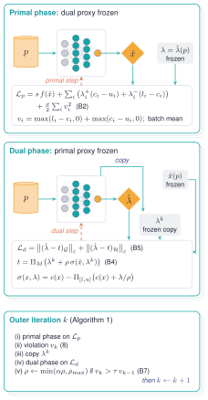

```@meta
CurrentModule = L2OALM
DocTestSetup = :(using L2OALM, L2OCore)
```

# L2OALM.jl

```@raw html
<p class="eyebrow">Primal proxy · Dual proxy · Augmented Lagrangian</p>
<figure class="fig hero has-compact">
```
![Self-supervised primal-dual learning in three panels. Primal phase, dual proxy frozen: the parameters p enter the primal proxy, which outputs x-hat; with lambda equal to the frozen dual proxy output, the primal loss L_p (B2) is s f of x-hat plus the sum over rows of lambda_i plus times c_i minus u_i plus lambda_i minus times l_i minus c_i, plus rho over 2 times the sum of squared violations v_i; a dashed primal step updates the primal proxy. Dual phase, primal proxy frozen: p enters the dual proxy, which outputs lambda-hat; a frozen copy gives lambda^k; with x-hat frozen, the target t (B4) is the projection Pi_M of lambda^k plus rho sigma of x-hat and lambda^k, and the dual loss L_d (B5) is the smoothed norm of lambda-hat minus t on the inequality rows plus that on the equality rows; a dashed dual step updates the dual proxy. Outer iteration k (Algorithm 1): primal phase, violation v_k (8), copy lambda^k, dual phase, then rho is replaced by the minimum of alpha rho and rho max if v_k exceeds tau v_k minus 1 (B7); then k increases by one.](assets/diagrams/l2oalm--primal-dual.svg)


```@raw html
<figcaption><i>The primal proxy minimizes the augmented Lagrangian for the frozen dual proxy; the dual proxy learns the multiplier step computed from a frozen copy of itself; the outer iteration alternates the two phases and raises the penalty when the violation stalls.</i></figcaption>
</figure>
```

L2OALM trains two neural proxies for a family of constrained optimization
problems `min_x f(x; p) s.t. l ≤ c(x; p) ≤ u` indexed by parameters `p`: a
**primal proxy** `x̂(p)` and a **dual proxy** `λ̂(p)`. No solver is needed to
create training data. The proxies imitate the iterations of the augmented
Lagrangian method: the primal proxy minimizes the augmented Lagrangian for
the multipliers predicted by the dual proxy, and the dual proxy learns the
multiplier update. This is the PDL method of Park & Van Hentenryck,
*Self-Supervised Primal-Dual Learning for Constrained Optimization*, AAAI 2023
([arXiv:2208.09046](https://arxiv.org/abs/2208.09046)).

The package is an `L2OCore` primal-dual method, so it shares problems,
pipelines and evaluators with the other packages in the
[LearningToOptimize](https://github.com/LearningToOptimize) ecosystem.

## Where to start

  - [Theory](@ref): the optimization problem, the losses with the paper's
    equation numbers, and the properties of the method.
  - [Package guide](@ref): getting started with JuMP or ExaModels, the API
    concepts and the extension points.
  - [Design](@ref): how the package uses L2OCore, how GPU evaluation works,
    which machine-learning frameworks are supported, and how other
    primal-dual variants fit.
  - Examples: [PDL on a parametric QP](examples/qp.md) and
    [ExaModels and GPU kernels](examples/examodels.md).

## A first look

```jldoctest
julia> method = ALMMethod(; ρ_init = 1.0, α = 2.0, τ = 0.8, ρmax = 1e3);

julia> enforces_bounds(SigmoidBoundMap())   # variable bounds hold by construction
true

julia> update_penalty(method, 1.0, 0.9, 1.0)   # v_k > τ v_{k-1}: ρ grows by α
2.0

julia> update_penalty(method, 1.0, 0.5, 1.0)   # enough progress: ρ is kept
1.0
```
